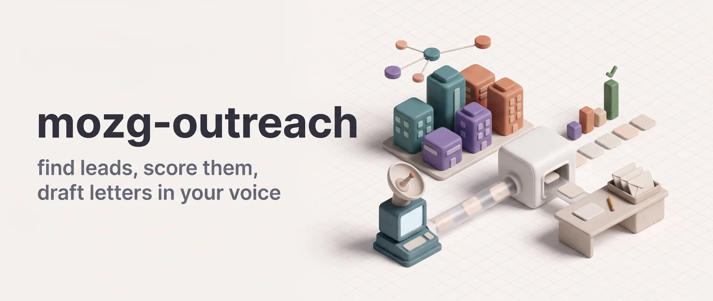
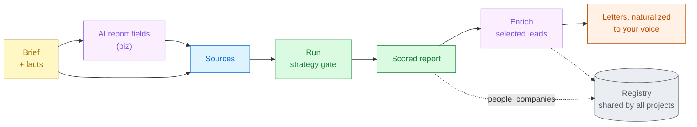

<p align="center"></p>

# mozg-outreach

<p align="center">
  
  
  
  
</p>

A local web service with a React UI for outreach. In `biz` mode it finds client companies. In `seeker` mode it finds job openings and freelance gigs for one person. Either way it scores what it finds, enriches the leads you pick and drafts letters in your own voice. The AI steps run on your locally installed Claude Code through the Claude Agent SDK, using your subscription login. Drafts only: it never sends anything.



- **Project = brief.** You write a brief, or let the AI draft it from your company's website (biz) or your CV (seeker). For biz projects the AI also proposes the report fields, and you edit and accept them. A brief can carry facts about you or your company that its fields have no place for. Agents and letters use them.
- **A gate before the search.** A run pauses at a strategy approval gate, so you can edit the plan before anything is searched.
- **Scores computed in Python.** Agents return per-axis features with a reason each. Weights are stored per project, and no model computes a composite score.
- **Evidence on every field.** Each extracted value links to its source and a quote. Contact data comes from a fetched page or a provider, never from the model, and a guessed email is labelled `guessed`.
- **Seeker scopes.** A seeker project searches salaried jobs, freelance gigs or both, each with its own recency window and size.
- **Letters in your voice.** Cover letters, proposals, emails and DMs are rewritten toward a profile built from your writing samples and style rules. Python then checks word budget, preserved entities, salutation, sign-off and punctuation, and reverts a rewrite that damaged the draft.
- **One registry.** People and companies from all projects live in one global registry with profiles, the sources each was seen in, merge suggestions and a graph. Exact identifiers merge automatically. Fuzzy matches are only suggested.
- **Local and keyless.** The server binds to `127.0.0.1`. There is no Anthropic API key.

## Quick start

Requires Python 3.12 and [uv](https://docs.astral.sh/uv/), Node.js with npm to build the UI, and Claude Code installed and logged in.

```bash
uv sync
npm --prefix ui ci --ignore-scripts
npm --prefix ui run build
uv run mozg-outreach
```

Open <http://127.0.0.1:8742>. The server has no auth, because it drives your Claude Code login. If `ui/dist` is missing, the API starts without the UI.

> [!WARNING]
> If `ANTHROPIC_API_KEY` is set in the environment, agent runs bill the API instead of your subscription. The service logs a warning at startup when it sees one.

**Contents:** [Workflow](#a-typical-biz-workflow) · [Data sources](#data-sources) · [Telegram](#telegram) · [Configuration](#configuration) · [Cost](#cost) · [Development](#development) · [License and origin](#license-and-origin)

## A typical biz workflow

1. Open **Projects**, create a project in `biz` mode and fill in the brief. On the **Brief** tab, **Write with AI** drafts it from your company's website. Add an optional note (goal, target regions, companies to avoid). The draft fills the form unsaved, so check it and press Save.
1. On the **Fields** tab, propose fields, edit them and accept the version. Biz projects only. **Write with AI** already drafts a proposal, which waits here for review.
1. On the **Sources** tab, check that web search is listed (every project gets it by default).
1. On **Runs**, start a run. When it shows `awaiting_gate`, review the strategy, edit it if needed and approve.
1. When the run finishes, open the **Report** tab. Leads are scored, and each field links to its source and a quote.
1. Open a lead, tick **selected**, then **Enrich** and **Write letters**. The first pass is a draft you can edit and save.
1. Browse **Registry** for people and companies, their sources, merge suggestions and the graph.

Before step 6, open **Voice** and paste messages you wrote yourself, per channel (`email`, `dm`, `cover_letter`, `proposal`). Add style rules, one per line, and build the profile. Your rules win over inferred style. Set your name and tone (`warm`, `neutral` or `formal`) in the **Sender** section of the Brief tab: they pick the salutation and sign-off of every letter.

Seeker projects work the same way without the fields step. **Write with AI** takes your CV pasted as text instead of a URL, and the brief picks jobs, gigs or both. Gigs have no enrich action: you go from selected gig to proposal.

The project page also has a **Delete project** button. After a second click it removes the project's runs, report and drafts. People and companies stay in the registry.

## Data sources

Web search is available to every mode: agents search and read the web. Feed adapters serve seeker projects only and give jobs. Kinds registered in `src/mozg_outreach/sources/factory.py`:

`greenhouse`, `lever`, `ashby`, `remotive`, `remoteok`, `arbeitnow`, `hn_whoishiring`, `telegram`

Add a source on the **Sources** tab by picking a kind and editing its JSON config.

### Telegram

Telegram reads channels you list in the config, using your own account.

```bash
export TELEGRAM_API_ID=...
export TELEGRAM_API_HASH=...
uv run python -m mozg_outreach.sources.telegram_login
```

The login prompts for your phone number, code and 2FA password, then saves a session file. The default location is `~/.local/share/mozg-outreach/telegram.session`. Override the base path with `MOZG_TELEGRAM_SESSION`. The session file grants full access to your account. Keep it private, outside any workspace, and never paste it into a prompt. Telegram's [API terms](https://core.telegram.org/api/terms) (clause 1.5) forbid using data from Telegram to train or build AI models.

## Configuration

| Variable                               | Default                                 | Meaning                                                     |
| -------------------------------------- | --------------------------------------- | ----------------------------------------------------------- |
| `MOZG_OUTREACH_HOME`                   | `~/.local/share/mozg-outreach`          | Data directory: `outreach.db` and per-project `workspaces/` |
| `MOZG_OUTREACH_PORT`                   | `8742`                                  | Port on `127.0.0.1`                                         |
| `MOZG_OUTREACH_MAX_RUNS`               | `2`                                     | Runs that may execute in parallel                           |
| `TELEGRAM_API_ID`, `TELEGRAM_API_HASH` | none                                    | Telegram API credentials                                    |
| `MOZG_TELEGRAM_SESSION`                | `~/.local/share/mozg-outreach/telegram` | Telegram session file base path                             |

## Cost

Every agent step uses Claude Code subscription usage. The run page shows the cost of each run in USD. One **Write with AI** draft costs roughly $0.35 to $0.40 of usage (measured), because it runs two agent calls: the brief and the report fields. Live tests (below) also spend subscription usage.

## Development

```bash
uv run pytest                  # offline; replays recorded agent outputs
uv run pytest -m live          # real Claude Code and web calls, costs usage
pre-commit run --files <files> # ruff, ruff-format, mdformat, mypy --strict, ui typecheck
npm --prefix ui run dev        # Vite on :5173, proxies /api to 127.0.0.1:8742
```

Run the Python service in another terminal for the dev server. Agent prompts live in `prompts/`, and `CLAUDE.md` explains the architecture decisions.

## License and origin

GPL-3.0-or-later, see `LICENSE`. The agent prompts were first written for the `mz-biz-outreach`, `mz-job-outreach` and `mz-creative` plugins in [claude-pipelines](https://github.com/DoctorMozg/claude-pipelines), and are relicensed here by the same author. Details are in `PROVENANCE.md`.
